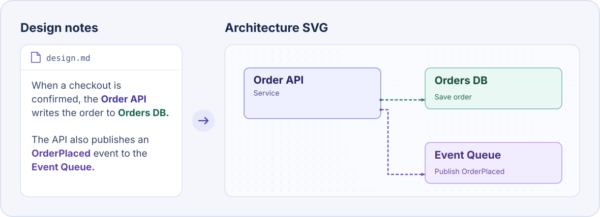

# arch-draw

[English](README.md) · **한국어**

프로젝트 파일과 설계 아이디어를 한눈에 볼 수 있는 SVG 아키텍처 다이어그램으로 바꿉니다.

[](examples/rendered/readme-demo/overview.svg)

[입력 설계 메모](examples/inputs/readme-demo/design.md) · [생성된 전체 SVG](examples/rendered/readme-demo/overview.svg)

프로젝트나 파일을 분석해 배치 검사를 거친 `overview.svg`를 만들고, 하위 구조는 상세 SVG로 펼칩니다. 진입 스킬인 `architecture-svg`는 소프트웨어, RTL, 보드 회로, 인프라, 인터페이스 계약, 데이터 흐름, AI 시스템, 설계 문서에 맞는 전문 스킬을 선택합니다. 전문 스킬 8개는 각각 직접 호출할 수도 있습니다.

## Codex와 Claude Code에서 사용하기

이 저장소를 클론한 뒤 Python 3.10 이상으로 클론한 폴더에서 `python install_skills.py`를 실행합니다. `pip install` 없이 사용할 수 있습니다.

```text
python install_skills.py <project-folder>
```

`<project-folder>`에는 분석할 프로젝트 경로를 넣습니다. 생략하면 현재 폴더에 설치합니다. `--host codex` 또는 `--host claude`를 사용하면 한쪽에만 설치할 수 있습니다. 설치 후 분석할 프로젝트에서 로컬 세션을 시작하세요. 설치 스크립트는 같은 스킬을 `.agents/skills/`와 `.claude/skills/`에 복사합니다. 다시 실행하면 동일한 설치본은 그대로 사용하고, 내용이 다른 설치본은 충돌로 알려줍니다.

Windows에서 `python` 명령을 사용할 수 없다면 `py -3`로 실행하세요. `py -3 --version`으로 Python 3.10 이상인지 확인할 수 있습니다. 렌더러를 직접 실행할 때는 PowerShell의 `New-TemporaryFile`로 중간 그래프 JSON을 저장할 수 있습니다.

- **Codex CLI 또는 데스크톱**에서 `$architecture-svg 현재 주문 서비스의 API와 배포 구조를 그려줘.`
- **Claude Code CLI 또는 데스크톱 Code 탭**에서 `/architecture-svg hardware/와 firmware/의 보드, RTL, 펌웨어 연결을 그려줘.`
- **전문 스킬 직접 호출**은 `$architecture-rtl design.f를 기준으로 top.sv를 그려줘.` 또는 `/architecture-rtl design.f를 기준으로 top.sv를 그려줘.`처럼 사용합니다.

스킬은 에이전트가 접근할 수 있는 작업 폴더의 소스와 설정을 읽습니다. 분류기가 관련 분야를 찾으면 모델이 근거를 검토해 그래프를 만듭니다. 렌더러가 모든 다이어그램을 배치하고 검사하면 모델이 결과를 소스와 대조합니다.

## 예제와 로컬 검증

`examples/inputs/`에는 8개 분야의 입력과 혼합 프로젝트 예제 두 개가 있습니다. `examples/graphs/`에는 모델을 다시 호출하지 않고 SVG를 재현할 수 있도록 검토한 그래프 입력을 넣었습니다. 근거, 연결 끝점, 방향을 기록하는 방법은 [그래프 형식 문서](skills/architecture-svg/references/graph.md)에서 확인할 수 있습니다.

[앱·API 계약·배포](examples/rendered/app-stack/overview.svg), [펌웨어·RTL·보드](examples/rendered/device-stack/overview.svg), [OpenTitan UART UVM 테스트벤치](examples/rendered/opentitan-uart-uvm/overview.svg) 예제를 열어볼 수 있습니다. [OpenTitan 예제 설명](examples/rendered/opentitan-uart-uvm/README.md)에는 분석한 소스 커밋과 SVG를 다시 만드는 방법이 있습니다. `detail`로 표시된 블록을 누르면 해당 상세 SVG가 열립니다.

```text
python skills/architecture-svg/scripts/classify.py examples/inputs/mixed/app
python skills/architecture-svg/scripts/render_svg.py examples/graphs/app-stack.json --out architecture
python -B -m unittest discover -s tests -v
```

`--out`에는 새 출력 폴더를 지정하세요. 생략하면 `architecture/`를 만들고, 이미 있으면 번호가 붙은 새 폴더를 만듭니다. 각 SVG에는 연결표가 있고, 블록이나 선에 마우스를 올리면 소스 근거를 볼 수 있습니다. 배선이 복잡한 경우 같은 연결 ID를 두 끝점에 표시해 연결표에서 추적할 수 있게 합니다.

## 지원 입력과 제한 사항

| 분야 | 대표 입력 | 분석 범위와 제한 |
| --- | --- | --- |
| 소프트웨어 | 소스 트리, 진입점, Git diff와 패치 | 컴포넌트의 소속 관계, 추적 가능한 호출과 메시지를 보여줍니다. 소스에서 동적 호출 대상을 확인할 수 없으면 미확인으로 표시합니다. |
| RTL과 UVM | Verilog (`.v`, `.vh`), SystemVerilog (`.sv`, `.svh`), 파일 목록과 빌드 설정 | 블록 계층, 주요 신호, 소스에서 확인할 수 있는 테스트벤치 연결을 보여줍니다. `generate` 분기, 신호 폭, 팩토리 오버라이드, 테스트별 연결은 제공된 설정에 따라 확인합니다. |
| 보드 | KiCad `.kicad_sch`, 내보낸 `.net` 또는 XML 넷리스트 | 회로 시트와 컴포넌트, 주요 넷, 커넥터, 전원 레일을 보여줍니다. 핀 연결을 확인하려면 넷리스트나 연결을 추적할 수 있는 회로도가 필요합니다. |
| 인프라 | Dockerfile, Docker Compose, Kubernetes 매니페스트, Terraform `.tf` | 선언된 리소스와 설정에 기록된 연결을 보여줍니다. 실제 실행 상태를 확인하려면 별도 근거가 필요합니다. |
| 인터페이스 | OpenAPI 또는 AsyncAPI YAML/JSON, Protobuf `.proto` 서비스 정의 | 선언된 작업과 채널을 보여줍니다. 실제 호출자와 배포 엔드포인트는 소스나 설정에서 확인합니다. |
| 데이터 흐름 | SQL DDL, dbt `manifest.json`, Airflow DAG 소스 | 선언된 관계, 데이터 계보, 작업 의존성을 보여줍니다. 작업 순서만으로는 데이터 이동 경로를 확정할 수 없습니다. |
| AI 시스템 | 모델 설정, 학습·추론 소스, RAG와 에이전트 워크플로 소스 | 소스에서 확인할 수 있는 모델 구성과 실행 흐름을 보여줍니다. 근거가 부족한 런타임 선택이나 텐서 형상은 미확인으로 표시합니다. |
| 시스템 설계 | 읽을 수 있는 텍스트로 제공한 설계 메모, 요구사항, ADR | 문서에 명시된 컴포넌트와 관계를 설계 의도로 표시합니다. |

분석 범위는 제공한 파일과 설정을 기준으로 합니다. RTL과 보드 다이어그램은 블록과 주요 연결을 보여줍니다. 전체 elaboration, 시뮬레이션, 전기적 규칙 검사(ERC)는 정적 소스 분석의 범위에 포함되지 않습니다.
