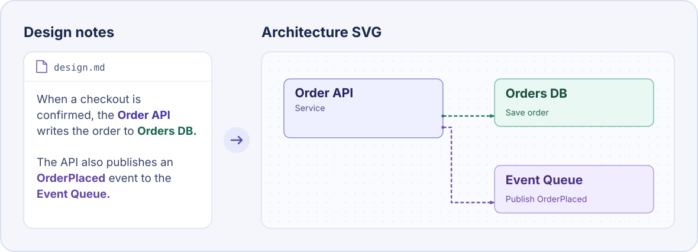

# arch-draw

**English** · [한국어](README.ko.md)

Turn project files and design ideas into clear SVG architecture diagrams.

[](examples/rendered/readme-demo/overview.svg)

[Input design notes](examples/inputs/readme-demo/design.md) · [Full generated SVG](examples/rendered/readme-demo/overview.svg)

Analyze a project or a set of files and create a verified `overview.svg` with detail diagrams for expanded groups. The `architecture-svg` entry skill chooses among software, RTL, board electronics, infrastructure, interface contracts, data workflows, AI systems, and design documents. Each of the eight specialists also works as a direct entry point.

## Latest update — November 18, 2026

- **Output boundaries** show the result, its destination or delivery surface, and the system or layer being drawn. This applies across the shared architecture workflow, including frontend, backend, tools and RTL.
- **Primary data flow** uses bold labels and thicker arrows from input through processing to output. Supporting paths remain visible, and main-path ports align across blocks where possible.
- **Frontend and backend examples** cover JSON-to-browser rendering and request-to-HTTP-response flow. Their reproducible graph inputs are in [frontend.json](examples/graphs/frontend.json) and [backend.json](examples/graphs/backend.json).

## Use in Codex and Claude Code

Clone this repository and run `python install_skills.py` from the checkout with Python 3.10 or newer. Setup runs directly from the checkout and requires no `pip install`.

```text
python install_skills.py <project-folder>
```

Omit `<project-folder>` to install into the current directory. Use `--host codex` or `--host claude` to install only one copy. Start a local session in the target project after installing. The installer copies the same sources into `.agents/skills/` and `.claude/skills/`. Rerunning it accepts identical copies and reports any conflicting copy for review.

On Windows, use `py -3` if `python` is unavailable, and check `py -3 --version` for Python 3.10+. PowerShell's `New-TemporaryFile` can hold the intermediate graph JSON when invoking the renderer manually.

- **Codex CLI or desktop:** `$architecture-svg Draw the current checkout service architecture, including API and deployment.`
- **Claude Code CLI or desktop Code tab:** `/architecture-svg Draw the board, RTL, and firmware paths in hardware/ and firmware/.`
- **Direct invocation:** `$architecture-rtl Draw top.sv using design.f.` or `/architecture-rtl Draw top.sv using design.f.`

The skills inspect source and configuration in the agent's accessible workspace. The classifier identifies candidate domains. The model reads the selected evidence and produces the graph. The renderer lays out and checks every diagram, and the model reviews the result against the sources.

## Examples and local checks

`examples/inputs/` contains source examples for all eight domains and two mixed projects. `examples/graphs/` contains hand-checked graph inputs for reproducing the rendered views independently of the model. The [graph contract](skills/architecture-svg/references/graph.md) documents evidence, endpoints and direction.

Open the rendered examples for [application, API contract and deployment](examples/rendered/app-stack/overview.svg), [firmware, RTL and board](examples/rendered/device-stack/overview.svg), or the [OpenTitan UART UVM testbench](examples/rendered/opentitan-uart-uvm/overview.svg). The [OpenTitan example notes](examples/rendered/opentitan-uart-uvm/README.md) link to the source revision and show how to reproduce the SVGs. A block marked `detail` links to its detailed SVG.

```text
python skills/architecture-svg/scripts/classify.py examples/inputs/mixed/app
python skills/architecture-svg/scripts/render_svg.py examples/graphs/app-stack.json --out architecture
python -B -m unittest discover -s tests -v
```

Choose a new directory for `--out`. If omitted, the renderer creates `architecture/` or the next available numbered directory. Each SVG includes a connection table and source evidence in tooltips. In dense views, the same connection ID appears at both endpoints and in the table, so the connection can still be followed after a wire is replaced by paired ports.

## Supported inputs and limits

| Domain | Representative inputs | Scope and limits |
| --- | --- | --- |
| Software | Source trees, entry points, Git diffs and patches | Component ownership and traceable calls or messages. Dynamic dispatch stays unresolved when the source leaves it open. |
| RTL and UVM | Verilog (`.v`, `.vh`), SystemVerilog (`.sv`, `.svh`), filelists and build settings | Block hierarchy, major signals and source-visible testbench connections. Generate branches, widths, factory overrides and test-specific connections depend on the supplied configuration. |
| Board | KiCad `.kicad_sch` or exported `.net`/XML netlist | Sheet and component blocks, major nets, connectors and rails. Pin membership needs the netlist or resolvable schematic evidence. |
| Infrastructure | Dockerfile, Docker Compose, Kubernetes manifests, Terraform `.tf` | Declared resources and configured connections. Runtime state needs separate evidence. |
| Interfaces | OpenAPI or AsyncAPI YAML/JSON, Protobuf `.proto` service definitions | Declared operations and channels. Concrete callers and deployed endpoints need source or configuration evidence. |
| Data flow | SQL DDL, dbt `manifest.json`, Airflow DAG source | Declared relations, lineage and task dependencies. Task order alone leaves data movement unknown. |
| AI systems | Model configuration, training or inference source, RAG and agent workflow source | Source-visible model and orchestration paths. Runtime choices and tensor shapes stay unresolved when inputs are missing. |
| System design | Design notes, requirements or ADRs supplied as readable text | Explicit components and relationships are marked as design intent. |

Analysis uses the files and configuration you provide. RTL and board outputs show blocks and major links. The tool performs static source review; full elaboration, simulation and electrical rule checking are outside its scope.
