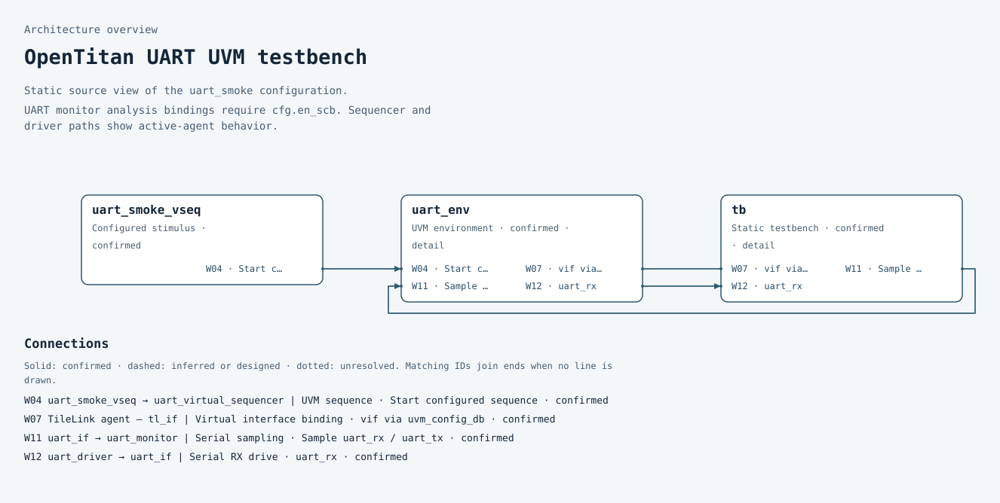

# OpenTitan UART UVM testbench

This example follows `uart_smoke` in OpenTitan at [`519525420465b6d7b4bdbb8312adec4d85e9056b`](https://github.com/lowRISC/opentitan/tree/519525420465b6d7b4bdbb8312adec4d85e9056b/hw/ip/uart/dv). The graph comes from static review of the SystemVerilog and test configuration at that revision.



- [UVM environment](detail-env.svg) shows the virtual sequencer, the UART and TileLink agents, and the paths into the scoreboard's analysis FIFOs.
- [Static testbench](detail-tb.svg) shows the DUT, clock and reset, and the serial and TileLink interfaces.
- [UART agent](detail-uart-agent.svg) shows sequence items reaching the driver, serial signals reaching the monitor, and monitor items reaching the scoreboard.

The [`uart_smoke` configuration](https://github.com/lowRISC/opentitan/blob/519525420465b6d7b4bdbb8312adec4d85e9056b/hw/ip/uart/dv/uart_sim_cfg.hjson#L47-L57) selects the sequence. The [base test](https://github.com/lowRISC/opentitan/blob/519525420465b6d7b4bdbb8312adec4d85e9056b/hw/dv/sv/dv_lib/dv_base_test.sv#L125-L149) starts it on the environment's virtual sequencer. The [testbench](https://github.com/lowRISC/opentitan/blob/519525420465b6d7b4bdbb8312adec4d85e9056b/hw/ip/uart/dv/tb/tb.sv#L31-L98) wires the DUT and registers virtual interfaces. The [UART environment](https://github.com/lowRISC/opentitan/blob/519525420465b6d7b4bdbb8312adec4d85e9056b/hw/ip/uart/dv/env/uart_env.sv#L15-L31) and [CIP base environment](https://github.com/lowRISC/opentitan/blob/519525420465b6d7b4bdbb8312adec4d85e9056b/hw/dv/sv/cip_lib/cip_base_env.sv#L152-L177) supply the monitor and sequencer bindings.

The diagrams cover the main stimulus and checking paths. UART monitor bindings depend on `cfg.en_scb`, and the driver and sequencer paths show the active-agent case. The example omits alerts, interrupts, and coverage plumbing. It was reviewed against source without running a simulation.

To regenerate the SVGs, run this from the `arch-draw` checkout with a new output directory. The [saved graph](../../graphs/opentitan-uart-uvm.json) records source paths and line numbers relative to the pinned OpenTitan checkout.

```text
python skills/architecture-svg/scripts/render_svg.py examples/graphs/opentitan-uart-uvm.json --out opentitan-uart-uvm
```
